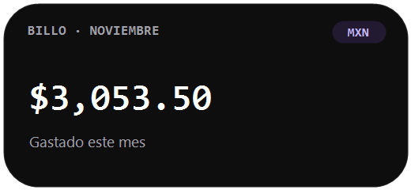
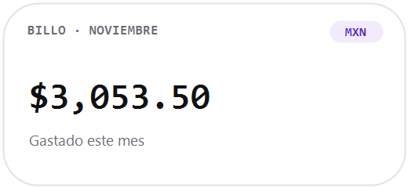
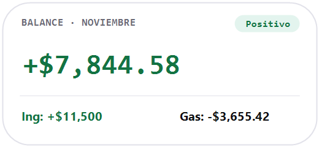
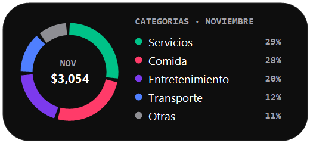
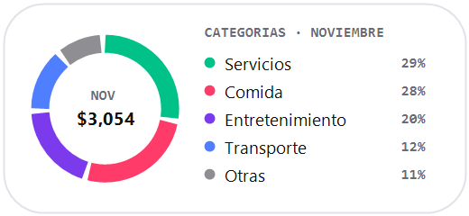

# Widgets de Android con el diseño de Billo (`feature/widgets-billo`)

Los cuatro widgets se declaran en `mobile/app.json` mediante el plugin `react-native-android-widget`, comparten el mismo almacén en `SecureStore` (`mobile/src/widget/datoWidget.js`), se actualizan en tiempo real con `mobile/src/widget/sincronizar.js` al abrir la app o al crear/editar/borrar gastos, ingresos y suscripciones, y se renderizan en **tema claro y oscuro** según el modo del sistema en tamaños **2×2** y **4×2**.

| Widget (`name`) | Etiqueta en Android | Qué muestra | Pantalla que abre al tocar |
|---|---|---|---|
| `ResumenMes` | **Billo** | Saldo disponible del mes y accesos a gasto, ingreso y voz (HU-58) | Abre la app; los accesos abren el registro correspondiente |
| `BalanceMes` | **Balance del mes** | Ingresos, gastos y balance neto (verde si positivo, rojo si negativo) | `Reportes › Balance` (`billo://balance`) |
| `DonaCategorias` | **Dona por categoría** | Dona SVG por categoría (máx. 5 segmentos y «Otras») con el total al centro | `Reportes › Gastos` (`billo://dona`) |
| `ProximoCobro` | **Próximo cobro** | Servicio, monto y días restantes para el siguiente cobro (`proximoCobro`) | `Cartera › Suscripciones` (`billo://cobro`) |

## Actualización y sesión

- Los cuatro widgets con datos solicitan una actualización cada 30 minutos. Android puede
  posponerla por ahorro de batería; al abrir la app o guardar cambios se solicita de inmediato.
- Se guardan las fechas y frecuencias de las suscripciones activas. Cada redibujado recalcula
  los días y el siguiente servicio sin red, incluyendo ciclos mensuales y anuales. Al cambiar
  de mes, los importes mensuales muestran el estado vacío hasta sincronizar; Próximo cobro
  puede seguir calculándose con las fechas guardadas.
- El formato del almacén tiene versión y propietario de sesión en SecureStore. Los formatos
  anteriores muestran «Abre Billo» hasta abrir la app con conexión y volver a sincronizar.
- Cerrar sesión invalida las actualizaciones pendientes y borra después de las escrituras
  iniciadas. El modo visitante no guarda datos en los widgets.

## Casos de regresión

1. Con una sincronización pendiente, cerrar sesión y dejar que termine: ningún widget debe
   volver a mostrar importes de esa cuenta. Repetir entrando después con otra cuenta.
2. Guardar suscripciones y mantener la app cerrada: al actualizar el widget, comprobar los
   días restantes y que cambie de servicio cuando pase el primer cobro. Repetir sin conexión.
3. Actualizar desde una versión con el formato anterior: comprobar el estado vacío antes de
   abrir la app y los importes correctos después de sincronizar.

---

## Capturas en tema oscuro y claro

### 1. Resumen del mes (`ResumenMes`)
| Tema oscuro | Tema claro |
|---|---|
|  |  |

### 2. Balance del mes (`BalanceMes`)
| Tema oscuro | Tema claro |
|---|---|
|  |  |

### 3. Dona por categoría (`DonaCategorias`)
| Tema oscuro | Tema claro |
|---|---|
|  |  |

### 4. Próximo cobro (`ProximoCobro`)
| Tema oscuro | Tema claro |
|---|---|
|  |  |
