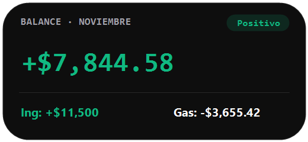
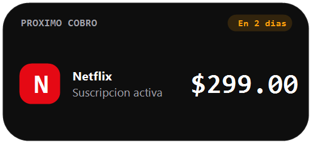
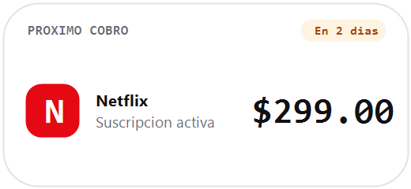

# Widgets de Android con el diseño de Billo (`feature/widgets-billo`)

Los cuatro widgets se declaran en `mobile/app.json` mediante el plugin `react-native-android-widget`, comparten el mismo almacén en `SecureStore` (`mobile/src/widget/datoWidget.js`), se actualizan en tiempo real con `mobile/src/widget/sincronizar.js` al abrir la app o al crear/editar/borrar gastos, ingresos y suscripciones, y se renderizan en **tema claro y oscuro** según el modo del sistema en tamaños **2×2** y **4×2**.

| Widget (`name`) | Etiqueta en Android | Qué muestra | Pantalla que abre al tocar |
|---|---|---|---|
| `ResumenMes` | **Resumen del mes** | Gasto total del mes en curso | `Inicio` (`billo://inicio`) |
| `BalanceMes` | **Balance del mes** | Ingresos, gastos y balance neto (verde si positivo, rojo si negativo) | `Reportes › Balance` (`billo://balance`) |
| `DonaCategorias` | **Dona por categoría** | Dona SVG por categoría (máx. 5 segmentos y «Otras») con el total al centro | `Reportes › Gastos` (`billo://dona`) |
| `ProximoCobro` | **Próximo cobro** | Servicio, monto y días restantes para el siguiente cobro (`proximoCobro`) | `Cartera › Suscripciones` (`billo://cobro`) |

---

## Capturas en tema oscuro y claro

### 1. Resumen del mes (`ResumenMes`)
| Tema oscuro | Tema claro |
|---|---|
|  |  |

### 2. Balance del mes (`BalanceMes`)
| Tema oscuro | Tema claro |
|---|---|
|  |  |

### 3. Dona por categoría (`DonaCategorias`)
| Tema oscuro | Tema claro |
|---|---|
|  |  |

### 4. Próximo cobro (`ProximoCobro`)
| Tema oscuro | Tema claro |
|---|---|
|  |  |
