# QA — Cambio de moneda, voz y widget (RF11, RF12, RF13)

Fecha de preparación: **2026-11-14**, America/Mexico_City.
Actualización de resultados y capturas: **2026-11-15**.
Responsable de QA: **Luis Dorian**. Prioridad: **alta**.
Estado de trabajo documentado: **ejecución reportada y capturas incorporadas**;
aprobación por indicación del usuario registrada y revisión del PO pendiente.
Este archivo no actualiza ClickUp ni acredita avisos o aprobaciones del equipo.

Rama de entrega: `test/qa-rf11-rf12-rf13`, creada desde
`HU-79-QA-mejoras-suscripciones` para identificar el alcance de moneda, voz y
widget. Conserva la base original `HU-55-QA-de-RF7,-RF9-y-RF10`, solicitada por
el usuario al iniciar el trabajo. Los nombres `hu61-reporte.md` y
`hu61-evidencias/` se conservan para mantener las referencias existentes;
esta entrega corresponde al QA de RF11–RF13 de prioridad alta.
Commit de partida y código probado automáticamente:
`3455d4ad33bc80c73628b3f104d912a4e1bd4b05`.

## Alcance y condiciones

Se incorporaron **12 casos** al [plan de pruebas, sección 5.1](../plan-de-pruebas.md#51-hu-79-moneda-voz-y-widget-en-apk-hu-53):
6 de moneda, 2 de voz y 4 de widget. Los pasos completos y precondiciones están
en ese plan; esta matriz registra su ejecución y decisión. La
[guía de Android](hu61-evidencias/GUIA-ANDROID.md) permite ejecutarlos a mano.

El usuario confirmó Android y ejecución manual el 2026-11-14. El 2026-11-15
informó que todas las pruebas pasan y solicitó registrar RF11 como aprobado
aunque no cuenta con evidencia de esos seis casos. Aportó **19 SS de RF12/RF13**
desde la carpeta `CP-RF12-13` de su Escritorio de OneDrive. Se revisaron y copiaron
al repositorio, agrupadas por caso y con descripción en el anexo de este reporte.
Los resultados declarados por el usuario se distinguen de lo comprobable en SS.

En **CP-RF13-02**, el usuario aclaró que la suscripción de $100 tenía la fecha
de cobro programada para después y aún no generaba deuda; para esa variante
indicó que el total 0 era correcto. La revisión anterior la comparó con la
variante del plan que esperaba sumar un cobro del periodo. Se corrige a
**Pasa (reportado)** y se retira la clasificación como bug. No se modifica
el valor de las SS ni se afirma haber probado la variante con cobro exigible.

Actualización **2026-11-15**: el usuario solicita **solo capturas de pantalla
(SS, PNG/JPG)** para toda evidencia manual. Enlazar imágenes por caso, variante
y paso. En reinicio y otros flujos, acompañar las SS con el registro escrito
de acciones, horas y valores observados. Las salidas automáticas `.tap` se
conservan como soporte de las corridas ya realizadas.

El contrato del repositorio es [v1.4](../api-contrato.md), aunque la historia
cita v1.2. Se usan las secciones vigentes de gastos, membresías y divisas y las
[decisiones de esquema](../decisiones-esquema-sprint3.md); su aprobación pendiente
no se da por resuelta. El PO debe revisar esta diferencia antes de cerrar.

| Dependencia | Evidencia en la rama | Condición pendiente para el APK |
|---|---|---|
| HU-53 | Enlace de APK documentado en `mobile/README.md`; perfil release en `mobile/eas.json` | Confirmar build instalado, hash, API, SDK y commit que incluye las mejoras |
| HU-56 | Utilidades de divisas, selección en Nuevo gasto y endpoint con token | Pasa y aprobación reportados por usuario; SS de RF11 no aportadas |
| HU-57 | Dictado nativo y parser; guía `hu57-voz.md` | SS de dictado, ruido, silencio y guardado incorporadas; build por identificar |
| HU-58 | Widget, dato persistido y sincronización con resumen | SS de widget/reinicio/aislamiento incorporadas; cuatro casos Pasa reportados por el usuario |
| HU-59 | La historia la declara dependencia; sus criterios no están identificados en la documentación revisada | Confirmar con el equipo su alcance y entrega en HU-53 |

El título refiere HU-71 a HU-78. La rama permite relacionar HU-71 con totales
mensual/anual, HU-72 con búsqueda/orden, HU-73 con cobros semanales, HU-74 con
duplicados, HU-75 con pausa/reactivación y HU-77 con moneda por suscripción.
Las suites existentes cubren lógica de esas mejoras; RF11 incluye HU-77 en
Android y RF13 comprueba el resumen con suscripciones. No se declara aprobación
individual de HU-71 a HU-78. Los criterios completos de HU-76/HU-78 no fueron
aportados; su trazabilidad y cualquier regresión adicional se deben acordar
antes de dar por cubierta toda esa serie.

## Ficha de ejecución manual

Los datos faltantes se conservan como por confirmar. El SDK y commit del checkout no identifican
el contenido del APK. El enlace conocido está en [mobile/README.md](../../mobile/README.md#apk-de-entrega-hu-53);
no se verificó su contenido ni su disponibilidad en esta corrida.

| Campo | Valor |
|---|---|
| Ejecutor / fecha y hora local | Usuario que aporta las SS; nombre de ejecutor por confirmar. Capturas rotuladas del domingo 15/nov, mes NOVIEMBRE; horas visibles de widget 12:18–13:02 y voz 13:33–13:39. Año 2026 por contexto de entrega; zona del dispositivo por confirmar. Recepción: 2026-11-15, America/Mexico_City. |
| Modelo / Android / launcher y versión | Pendiente |
| URL o build de HU-53 / archivo APK | Pendiente |
| SHA-256 / versión / versionCode instalados | Pendiente |
| Commit de origen del APK / SDK incluido | Pendiente; si no se conoce, indicarlo y solicitar trazabilidad |
| Perfil / Metro | Debe ser release, sin Metro para widget y reinicio; por verificar |
| API usada por el APK / versión del backend | Pendiente |
| Cuenta QA A / cuenta QA B | Reinicio/aislamiento: A identificada en pantalla como Dorian, total 200; B como QA, total 0. Solo alias, sin credenciales. |
| Mes M / total inicial T / gasto fijo inicial F | NOVIEMBRE. CP-RF13-01: 69; CP-RF13-02: secuencia 80 → 95 → 0 → 0 → 0; CP-RF13-03: 200 antes/después; CP-RF13-04: A 200, B 0. F no documentado. |
| Fuente y mecanismo de fallo / estado de cachés | RF11 aprobado por usuario sin SS ni datos de tasa/fuente aportados |
| Reconocimiento es-MX / permisos / red | Escucha nativa y transcripción visibles; es-MX y configuración de permisos no identificados en SS |
| Incidencia de cambio de mes durante reinicio | NOVIEMBRE antes/después; no se observa cambio de mes |

## Resultados por caso

**Pasa (reportado)**: resultado comunicado por el usuario; la columna de SS
indica el soporte y sus límites. No implica una repetición independiente del
caso por esta revisión. **Falla**: incumplimiento observado en SS y confirmado
por el ejecutor, con bug enlazado.
**Pendiente**: no ejecutado. **Bloqueado**: falta una precondición, descrita en
la fila y en el registro de bloqueos. No convertir pendientes en fallas ni
resultados automáticos en pruebas del APK.

Para cada ejecución registrar fecha/hora, valores reales, variantes y evidencia
(archivos PNG/JPG o enlaces a SS ordenadas por paso). El resultado real debe describir qué ocurrió,
no copiar el esperado. Los pasos de cada ID están en el plan enlazado arriba.

| Caso | Esperado resumido | Resultado real | Resultado | Capturas Android (PNG/JPG) | Bug |
|---|---|---|---|---|---|
| CP-RF11-01 | Gasto 10 USD convertido con r, persistido y sumado una vez en MXN | Usuario reporta Pasa; no aporta tasa, valores reales ni SS | Pasa (reportado) | Sin evidencia, declarado por usuario | Sin defecto reportado |
| CP-RF11-02 | 502 sin tasa previa; aviso y captura manual de 80 MXN | Usuario reporta Pasa; respuesta 502 y captura manual no verificadas en esta revisión | Pasa (reportado) | Sin evidencia, declarado por usuario | Sin defecto reportado |
| CP-RF11-03 | Suscripción 10 USD con original, equivalente y total fijo correctos | Usuario reporta Pasa; conversión y persistencia sin SS para revisar | Pasa (reportado) | Sin evidencia, declarado por usuario | Sin defecto reportado |
| CP-RF11-04 | 502 sin tasa previa; aviso y suscripción manual de 99 MXN | Usuario reporta Pasa; respuesta y resultado guardado sin evidencia aportada | Pasa (reportado) | Sin evidencia, declarado por usuario | Sin defecto reportado |
| CP-RF11-05 | 502 con tasa previa; aviso de tasa conocida, conversión y persistencia correctas | Usuario reporta Pasa; no aporta estado de cachés, tasa ni SS | Pasa (reportado) | Sin evidencia, declarado por usuario | Sin defecto reportado |
| CP-RF11-06 | Edición a 199 MXN limpia original/tasa y reemplaza el costo en resumen | Usuario reporta Pasa; campos y totales no comprobados con evidencia | Pasa (reportado) | Sin evidencia, declarado por usuario | Sin defecto reportado |
| CP-RF12-01 | «Ochenta pesos en comida» llena 80/Comida y guarda solo al confirmar | SS de escucha con transcripción «$80», importe aún 0 durante escucha y Confirmar desactivado; SS posterior compartida con CP-RF12-02 muestra gasto de 80 en Comida. Usuario confirma Pasa. | Pasa (reportado) | [Dictado](#capturas-cp-rf12-01) y [lista posterior](#capturas-cp-rf12-02) | Sin defecto confirmado |
| CP-RF12-02 | Frase no interpretable, ruido y silencio: sin datos inventados; captura manual útil | Tres variantes conservan 80/Comida y muestran «No entendí el monto, escríbelo». Lista posterior: gasto manual 85 en Otros y gasto previo 80 en Comida, total 165. Variante de datos: se eligió Otros, aunque el plan propone Comida. | Pasa (reportado) | [4 SS](#capturas-cp-rf12-02) | Sin defecto confirmado |
| CP-RF13-01 | Widget aparece, muestra M/T y abre app | Widget visible en launcher con BILLO · NOVIEMBRE y 69.00. Usuario reporta aparición/apertura correctas; la SS no muestra el selector. | Pasa (reportado) | [1 SS](#capturas-cp-rf13-01) | Sin defecto confirmado |
| CP-RF13-02 | Gastos actualizan el total; en la variante ejecutada, suscripción con cobro posterior y sin deuda conserva T, según aclaración del usuario | SS: 80.00 → 95.00 → 0.00 → 0.00 → 0.00. La edición usó 95 en vez de 95.50. El usuario confirma que la suscripción de 100 tenía cobro posterior y no generaba deuda; 0 al crearla y borrarla es correcto para la variante reportada. | Pasa (reportado) | [5 SS](#capturas-cp-rf13-02) | Sin defecto reportado |
| CP-RF13-03 | Reinicio real: M/T conservados sin red, sin Metro y antes de abrir Billo | Antes 12:38 y después rotulado 12:39: NOVIEMBRE y 200.00; al tocarlo abre Inicio con 200 a las 12:40. SS previa en modo avión con Wi-Fi apagado; SS posterior muestra indicadores de red activos, por lo que continuidad sin red no queda acreditada. Reinicio y Pasa reportados por usuario. | Pasa (reportado) | [4 SS y alcance de evidencia](#capturas-cp-rf13-03) | Sin defecto confirmado |
| CP-RF13-04 | Logout borra total incluso tras reinicio; cuenta B muestra solo su total | Confirmación de logout de A; widget «Abre Billo» en SS rotulada tras reinicio; cuenta B (QA) muestra 0 en Inicio y widget, sin total 200 de A. | Pasa (reportado) | [4 SS](#capturas-cp-rf13-04) | Sin defecto confirmado |

Conteo de revisión: **12 casos; 12 Pasa (reportados), 0 Falla, 0 Pendiente,
0 Bloqueado**. De los 12 Pasa reportados, 6 son RF11 sin SS. CP-RF13-02
incluye la aclaración de fecha de cobro posterior y no se registra como defecto.

## Verificación automática de apoyo

Ejecutada el 2026-11-14 sobre el commit de partida, Windows, Node **v22.15.0**,
npm **10.9.2**. Se guardaron las salidas nuevas sin reemplazar evidencias de HU-55.

| Comando | Resultado observado | Evidencia | Qué verifica |
|---|---|---|---|
| `cd mobile; npm.cmd test` | **Pasa: 387/387**, 0 fallas, 0 omitidos, salida 0 | [mobile.tap](hu61-evidencias/mobile.tap) | Parser de voz, conversión, preparación de datos, resumen del widget y regresión de lógica |
| `cd backend; npm.cmd test` | **Pasa: 418/418**, 0 fallas, 0 omitidos, salida 0 | [backend.tap](hu61-evidencias/backend.tap) | API con PostgreSQL temporal, moneda de gastos/membresías, fuente/caché/502 y regresión HTTP |

La suite backend crea y elimina su propia base temporal; no migra ni trunca la
base de desarrollo. Las pruebas de divisas usan fuente controlada y no acreditan
disponibilidad real del proveedor. Estas dos corridas no acreditan la voz nativa,
el launcher, el reinicio, el APK ni la aprobación de ningún RF.
No se repitieron lint, doctor ni bundles: esta entrega modifica documentación
y guarda evidencia; no cambia código, dependencias ni configuración nativa.

## Pendientes para cerrar HU-61

Estos puntos no se pueden resolver desde el repositorio; requieren ejecutar en el
Android físico y aportar capturas (PNG/JPG):

- [ ] RF11 (CP-RF11-01 a 06): capturas de cada caso, con tasa y valores reales. Hasta entonces el resultado sigue siendo «Pasa (reportado)», sin evidencia.
- [ ] CP-RF13-03: repetir el reinicio con captura posterior **sin red** (modo avión / Wi-Fi apagado) para acreditar la continuidad sin red.
- [ ] CP-RF13-02: repetir la variante con cobro exigible del periodo.
- [ ] Permiso de micrófono negado (CP-RF12): decidir con el PO si se reincorpora o se documenta la exclusión.
- [ ] Ficha de ejecución: modelo, versión de Android, APK, SHA-256, commit y API usada.
- [ ] Revisión del PO.

## Decisión por requisito

| Requisito | Decisión registrada | Fundamento y dictamen de revisión |
|---|---|---|
| RF11 | **APROBADO por indicación del usuario** | Seis Pasa declarados sin evidencia adjunta. No se presenta como verificación independiente ni se da por cumplido el criterio de evidencia. |
| RF12 | **APROBADO por indicación del usuario** | Dos Pasa reportados y 5 SS revisadas, con la lista final compartida entre casos. Se describen los valores y variantes observados. |
| RF13 | **APROBADO por indicación del usuario** | Cuatro Pasa reportados y 14 SS. CP-RF13-02 usa cobro posterior sin deuda, con total 0 correcto según aclaración del usuario. No hay bug abierto. El reinicio conserva 200; continuidad sin red e identidad del build requieren completar trazabilidad. |

Dictamen registrado de HU-79: **RF11, RF12 y RF13 aprobados por indicación del usuario**.
La [lista de requisitos](../lista-requisitos.md) refleja esa aprobación. El reporte
queda para revisión del PO; no se declara el cierre formal de HU-79 ni el
desbloqueo de HU-62 desde este archivo. Quedan la evidencia faltante de RF11,
la trazabilidad del APK y el visto bueno del PO.
La aprobación por indicación del usuario no constituye firma independiente QA/PO.

## Bugs y aviso el mismo día

Las suites automáticas no mostraron fallas. **No hay bugs abiertos en esta
entrega**: la clasificación inicial de CP-RF13-02 se retiró al aclarar el usuario
que el cobro estaba programado para después y aún no generaba deuda.

Para cada Falla copiar [plantilla-reporte-bug.md](../plantilla-reporte-bug.md)
en `docs/qa/bugs/HU79-BUG-nn.md`. Incluir ID, caso/variante, build y API,
pasos/datos, esperado, real, evidencia, severidad, responsable acordado y
reprueba. Reutilizar un bug existente si es el mismo defecto. Completar la
siguiente tabla al registrar un defecto; no dejar una Falla sin bug asignado.

| Bug / caso | Severidad / estado | Responsable acordado | Reportado (fecha/hora local) | Avisado a / canal / fecha-hora / enlace | Reprueba y evidencia |
|---|---|---|---|---|---|
| Sin defectos abiertos | No aplica | No aplica | No aplica | No se enviaron avisos externos | No aplica |

Luis Dorian debe avisar al responsable el día del hallazgo en
America/Mexico_City y dejar la constancia del mensaje/tarea. Si falta asignación
o aviso, registrarlo como gestión pendiente; no declarar que ya ocurrió.

## Avance diario y bloqueos

| Fecha local | Avance documentado | Pendiente / siguiente acción |
|---|---|---|
| 2026-11-14 | Rama desde HU-55; 12 casos, guía y reporte preparados; mobile 387/387 y backend 418/418. Usuario confirma Android y elige pruebas manuales. | Identificar APK/dispositivo, ejecutar, incorporar resultados/evidencia y revisar con PO. Corte 11/nov ya transcurrido; preparación documentada 14/nov y entrega final 15/nov. |
| 2026-11-15 | Usuario elige SS como único formato de evidencia manual; guía, plan y reporte adaptados, incluido reinicio con capturas antes/después y bitácora. | Ejecutar y aportar SS por caso/variante; resultados y aprobación siguen pendientes. |
| 2026-11-15 | Incorporadas y revisadas 19 SS en seis carpetas; usuario declara todas las pruebas Pasa y aprueba RF11 sin evidencia. Aclara que la suscripción de CP-RF13-02 tenía cobro posterior sin deuda: total 0 correcto para esa variante; se retira la clasificación como bug. | Completar ficha del APK, evidencia de RF11 y revisión PO. |

Si una precondición impide probar, cambiar **el estado de la tarea a pendiente**,
añadir comentario y mencionarlo en Daily según la historia; registrar además
el caso como Bloqueado con motivo. Al resolver, volver a en progreso. El estado
externo no se ha cambiado desde este trabajo.

Comentario preparado para publicar si se confirma un bloqueo (completar campos):

> HU-79 pendiente por [dependencia/entorno/evidencia]. Afecta [casos/RF] y mantiene
> bloqueada HU-62. Para continuar se requiere [acción], a cargo de [responsable
> acordado]. Corte: 11/nov; entrega final: 15/nov. Siguiente revisión: [fecha/hora].

No se registra como bloqueo confirmado la falta de teléfono: el usuario sí
dispone de uno. Confirmar antes de ejecutar el build, la posibilidad de falla
de fuente en QA y la trazabilidad de HU-59/HU-76/HU-78.

## Cierre y revisión del PO

- [x] Casos agregados al plan y guía manual preparada.
- [x] Pruebas automáticas ejecutadas con evidencia propia.
- [ ] APK y Android físico identificados en la ficha.
- [x] Cada caso con resultado registrado y alcance de evidencia explícito; RF11 solo por declaración del usuario.
- [x] SS de RF12/RF13 incorporadas, agrupadas y descritas en el anexo.
- [ ] Cada variante con evidencia completa; faltan SS de RF11 y algunas precondiciones/metadatos.
- [x] Reinicio del widget con SS antes/después y apertura; NOVIEMBRE y 200 conservados.
- [ ] Completar continuidad sin red y trazabilidad del release del caso de reinicio.
- [x] Sin Fallas reportadas ni bugs abiertos tras aclarar la fecha de cobro de CP-RF13-02.
- [x] Decisiones actualizadas, distinguiendo aprobación por usuario y dictamen QA.
- [x] Aprobaciones solicitadas marcadas en la lista con sus salvedades.
- [ ] Diferencia v1.2/v1.4 y alcance/dependencias revisados con PO.
- [ ] QA: Luis Dorian, fecha y referencia de aprobación: pendiente.
- [ ] PO: nombre, fecha y referencia de visto bueno: pendiente.

Transiciones: por hacer → en progreso (avance diario) → en revisión (PO revisa
reporte completo) → completa (Luis Dorian, con visto bueno del PO). Este reporte
permanece abierto por las condiciones de cierre pendientes.

## Anexo — Capturas incorporadas

Se copiaron **19 imágenes JPEG** originales a carpetas por caso. Solo se
normalizaron los nombres y la extensión de `.jfif` a `.jpg`; el contenido
se conserva sin cambios. El [índice de capturas](hu61-evidencias/indice-capturas.json)
relaciona cada nombre original con su archivo y descripción.

### Capturas CP-RF12-01

Escucha con transcripción «$80», categoría Comida e importe 0 mientras el dictado sigue activo. Confirmar está desactivado en ese estado. El gasto final de 80 en Comida aparece en la última SS de CP-RF12-02, que también se usa como soporte de este caso.

1. **dictado 80 comida**. [Abrir SS](hu61-evidencias/CP-RF12-01/01-dictado-80-comida.jpg).

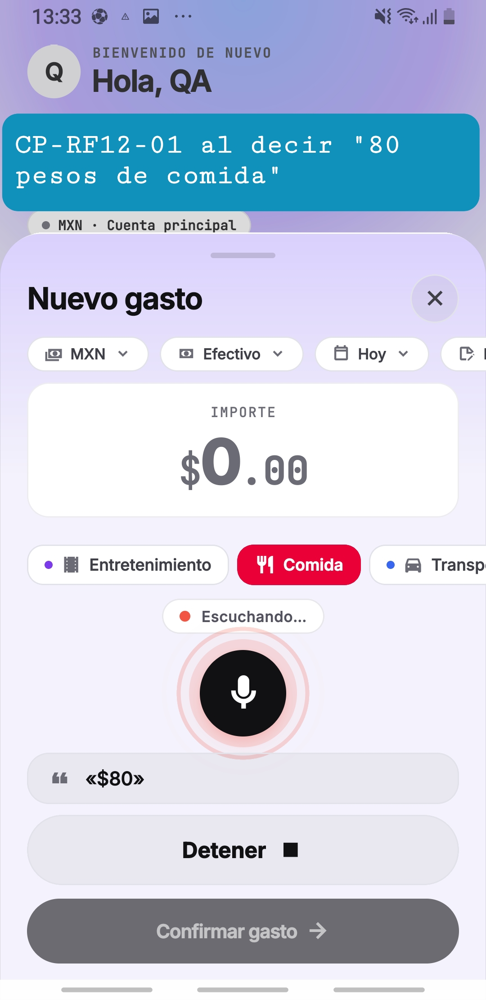

### Capturas CP-RF12-02

La frase no interpretable, el ruido y el silencio conservan los campos y muestran el aviso. El guardado manual posterior deja un gasto de 85 en Otros y el gasto anterior de 80 en Comida; total 165. La categoría manual difiere de la propuesta por el plan y se registra tal como aparece.

1. **frase no interpretable**. [Abrir SS](hu61-evidencias/CP-RF12-02/01-frase-no-interpretable.jpg).

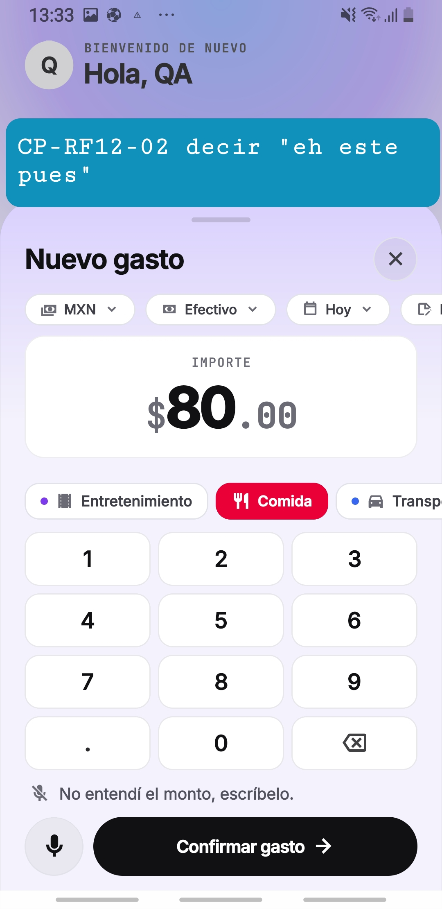

2. **ruido**. [Abrir SS](hu61-evidencias/CP-RF12-02/02-ruido.jpg).

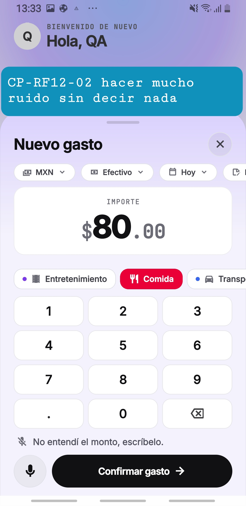

3. **silencio**. [Abrir SS](hu61-evidencias/CP-RF12-02/03-silencio.jpg).

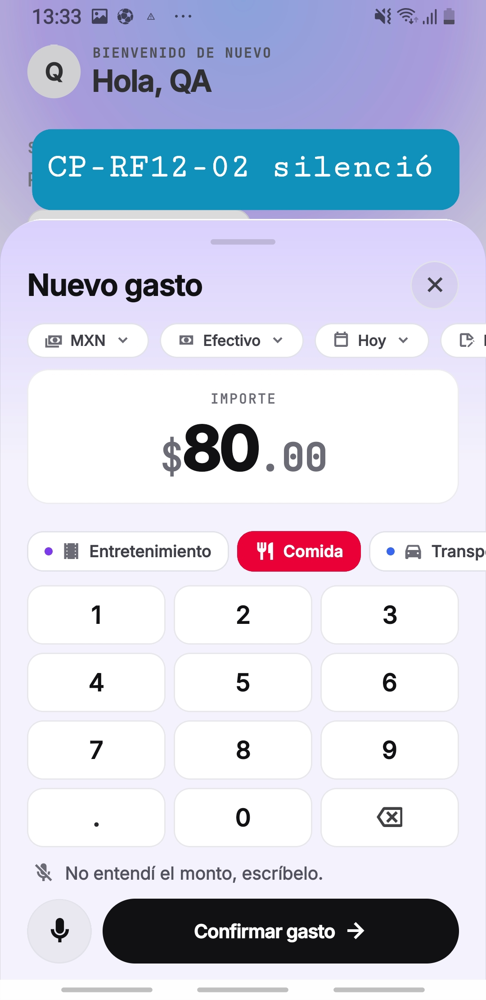

4. **guardado manual**. [Abrir SS](hu61-evidencias/CP-RF12-02/04-guardado-manual.jpg).

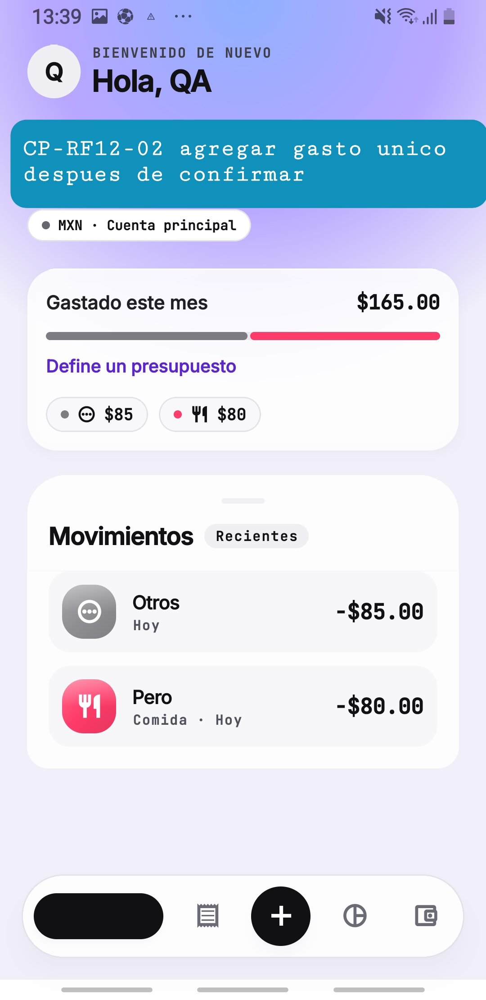

### Capturas CP-RF13-01

Widget visible con BILLO · NOVIEMBRE y total 69.00, a las 12:18. La imagen acredita su presencia en el launcher; el selector y el gesto de apertura no se ven en esta SS.

1. **widget visible**. [Abrir SS](hu61-evidencias/CP-RF13-01/01-widget-visible.jpg).

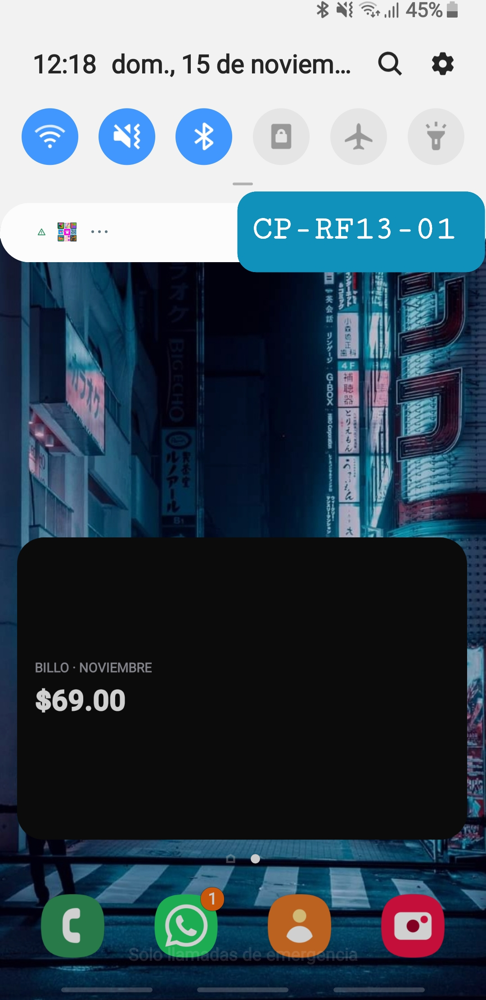

### Capturas CP-RF13-02

Secuencia visible: 80.00 al crear gasto, 95.00 al editar, 0.00 al borrar gasto, 0.00 al agregar la suscripción de 100 y 0.00 al borrarla. La edición usó 95.00 en lugar de los 95.50 propuestos. El usuario aclaró que la fecha de cobro era posterior y aún no generaba deuda: el total 0 es correcto para esa variante y el caso queda Pasa (reportado).

1. **gasto 80**. [Abrir SS](hu61-evidencias/CP-RF13-02/01-gasto-80.jpg).

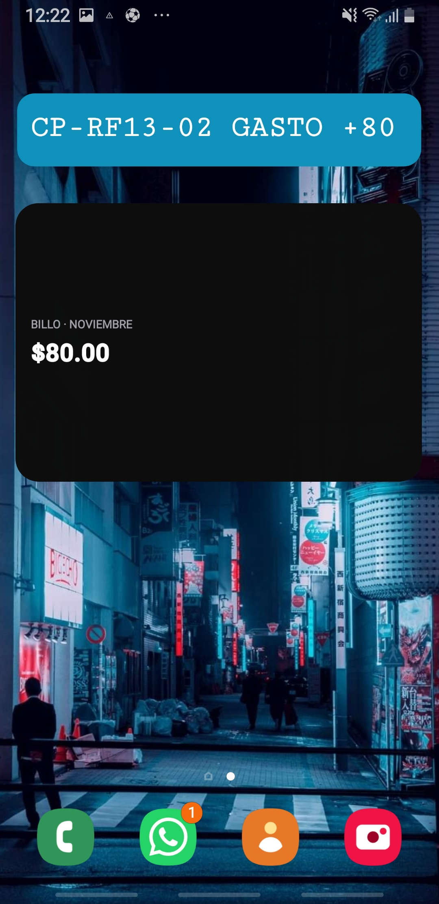

2. **edicion 95**. [Abrir SS](hu61-evidencias/CP-RF13-02/02-edicion-95.jpg).

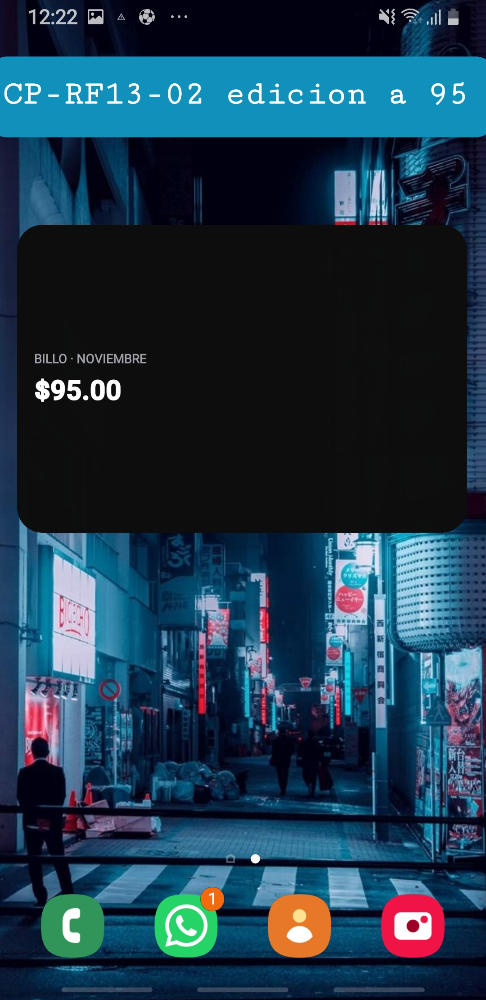

3. **borrado gasto**. [Abrir SS](hu61-evidencias/CP-RF13-02/03-borrado-gasto.jpg).

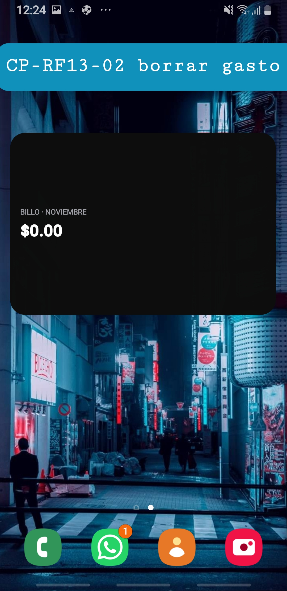

4. **alta suscripcion 100**. [Abrir SS](hu61-evidencias/CP-RF13-02/04-alta-suscripcion-100.jpg).

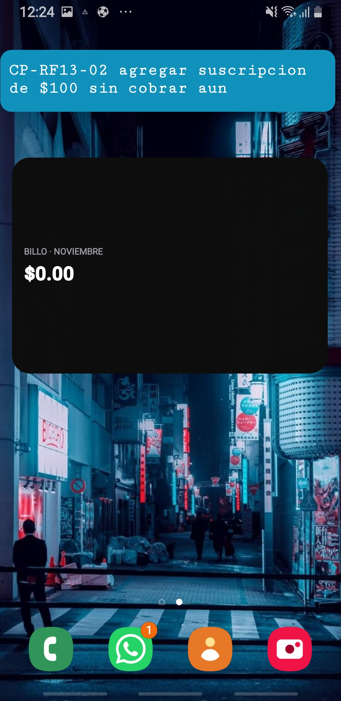

5. **borrado suscripcion**. [Abrir SS](hu61-evidencias/CP-RF13-02/05-borrado-suscripcion.jpg).

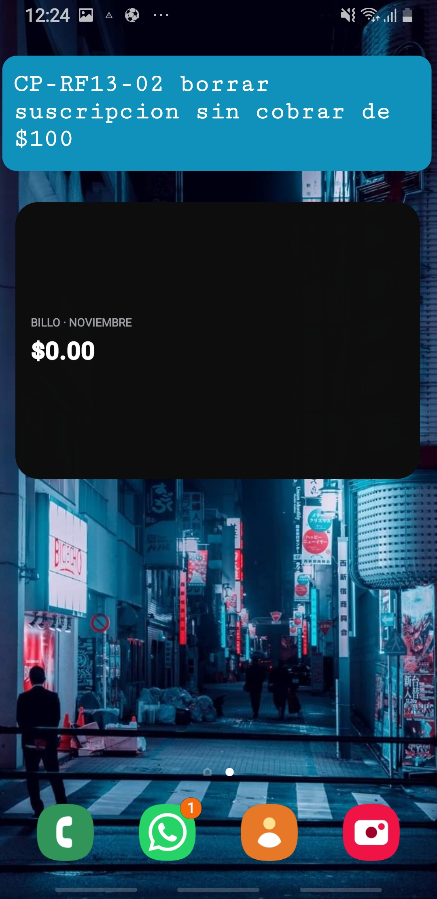

### Capturas CP-RF13-03

Antes, 12:38: NOVIEMBRE y 200.00. Sin red: modo avión activo y Wi-Fi apagado, mismo total. Después, 12:39: imagen rotulada por el ejecutor como posterior al reinicio antes de abrir Billo, mismo mes/total. Apertura, 12:40: Inicio también muestra 200.00. Los indicadores de red vuelven a aparecer después del reinicio; no se afirma continuidad sin red. No se aportó SS de tiempo de actividad ni identificación del build.

1. **antes reinicio**. [Abrir SS](hu61-evidencias/CP-RF13-03/01-antes-reinicio.jpg).

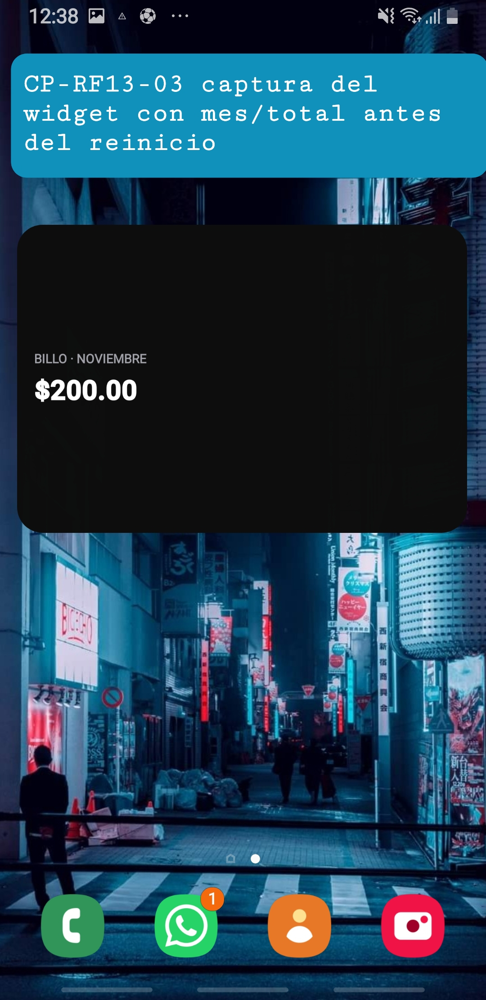

2. **sin red**. [Abrir SS](hu61-evidencias/CP-RF13-03/02-sin-red.jpg).

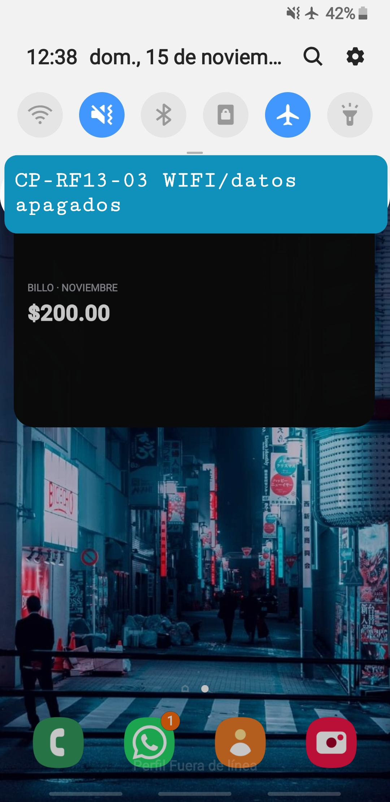

3. **despues reinicio**. [Abrir SS](hu61-evidencias/CP-RF13-03/03-despues-reinicio.jpg).

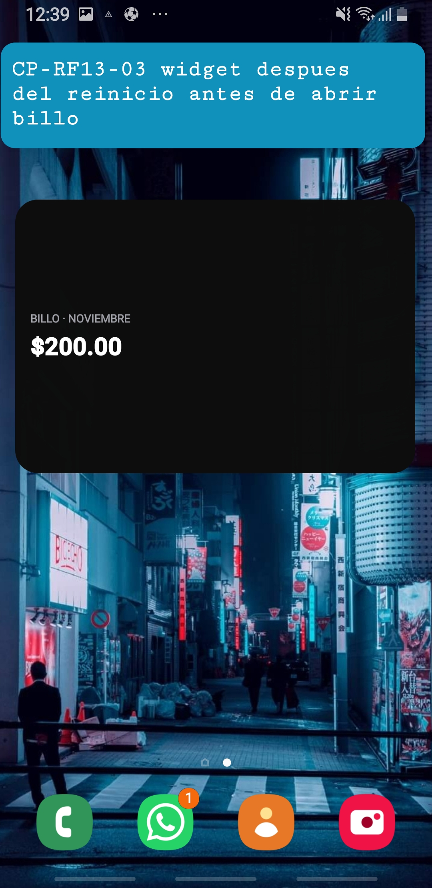

4. **apertura app**. [Abrir SS](hu61-evidencias/CP-RF13-03/04-apertura-app.jpg).

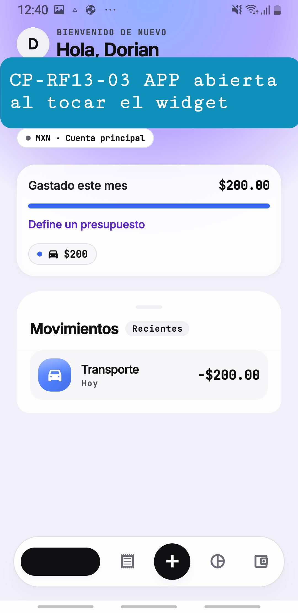

### Capturas CP-RF13-04

A muestra 200 y el diálogo de cierre de sesión. En la SS rotulada tras reinicio, el widget muestra «Abre Billo». B (QA) muestra 0 tanto en Inicio como en el widget. El archivo de logout llegó con nombre CP-RF14-04, pero la anotación dentro de la imagen dice CP-RF13-04; se agrupó por ese contenido sin modificar la imagen.

1. **confirmacion logout**. [Abrir SS](hu61-evidencias/CP-RF13-04/01-confirmacion-logout.jpg).

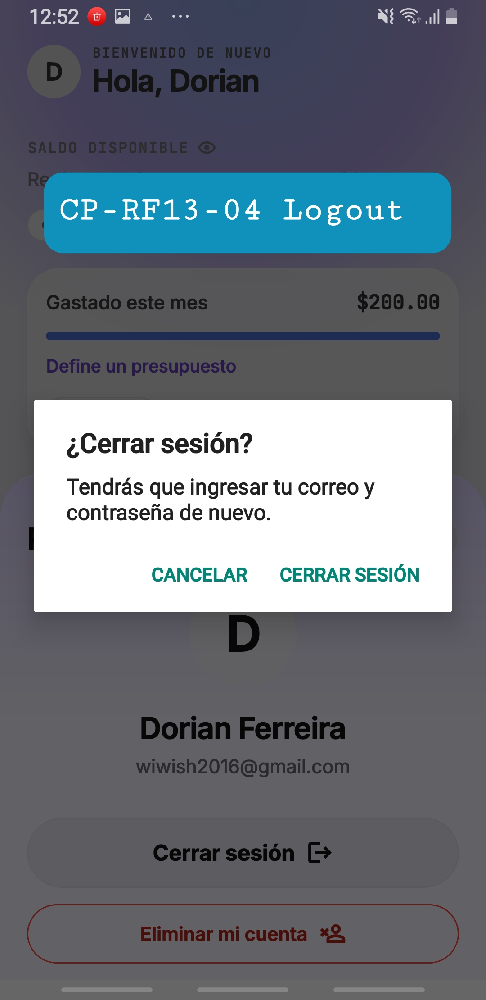

2. **sin sesion tras reinicio**. [Abrir SS](hu61-evidencias/CP-RF13-04/02-sin-sesion-tras-reinicio.jpg).

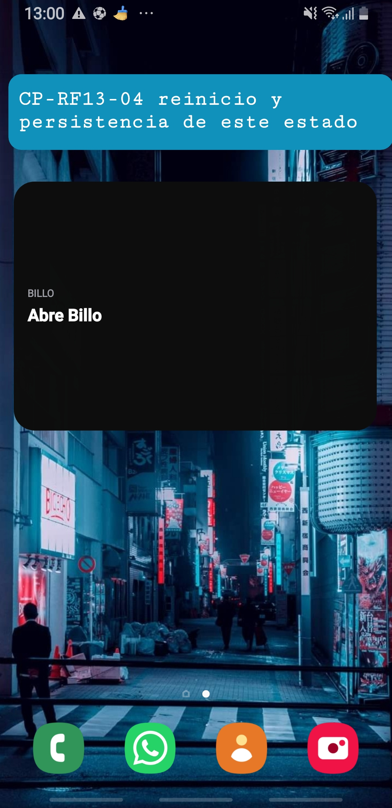

3. **inicio cuenta b**. [Abrir SS](hu61-evidencias/CP-RF13-04/03-inicio-cuenta-b.jpg).

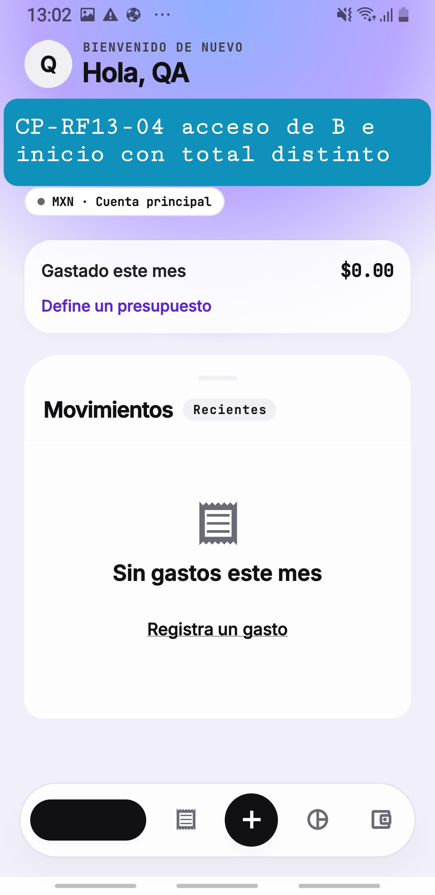

4. **widget cuenta b**. [Abrir SS](hu61-evidencias/CP-RF13-04/04-widget-cuenta-b.jpg).

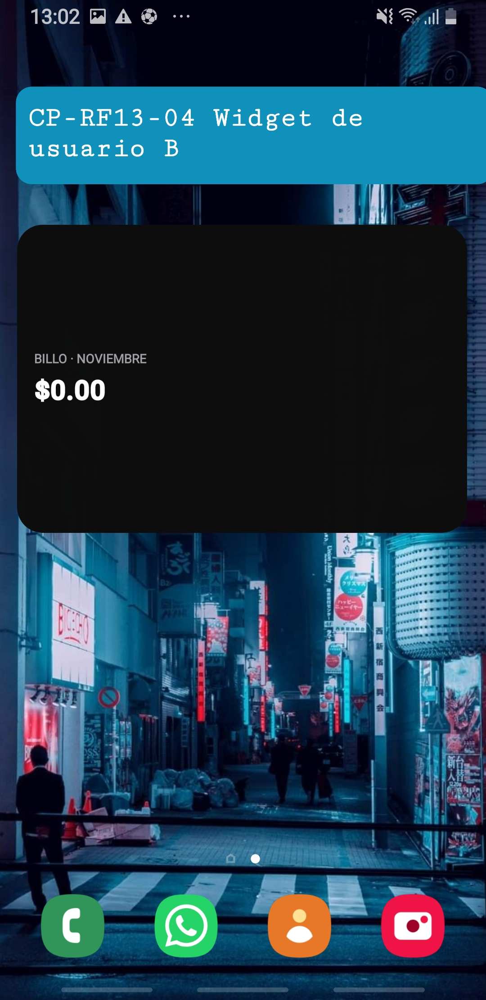
